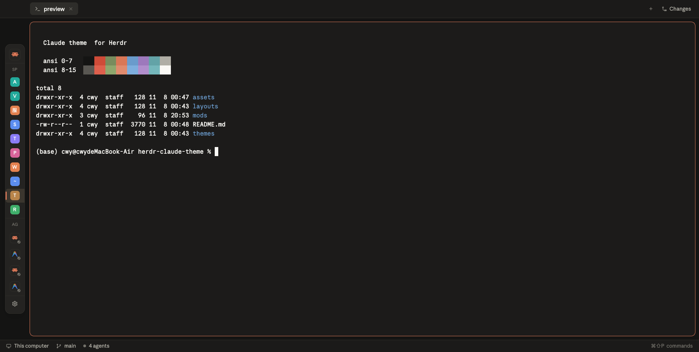
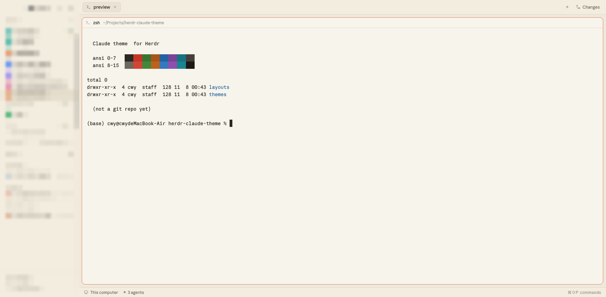

# Claude theme for Herdr

A warm, Claude-flavoured **dark + light** theme for [Herdr](https://herdr.app), plus the layout and the two mods it was designed around: a Claude-style drawer of spaces and agents, and a matching pane header. Both themes follow your system appearance automatically.

| Dark | Light |
|---|---|
|  |  |

## What's inside

| File | Goes to | What it does |
|---|---|---|
| `themes/claude-dark.json` | `~/.config/herdr-app/themes/` | terminal palette + panel colours, dark |
| `themes/claude-light.json` | `~/.config/herdr-app/themes/` | terminal palette + panel colours, light |
| `layouts/claude.json` | `~/.config/herdr-app/layouts/` | the window: no titlebar, 12px rounded panes, theme bound to `{ light, dark }` |
| `layouts/claude.svg` | `~/.config/herdr-app/layouts/` | the layout's preview thumbnail |
| `mods/claude-drawer/` | `~/.config/herdr-app/mods/claude-drawer/` | spaces + agents as a Claude-style drawer: 44px peek, hover to open, or docked in the sidebar |
| `mods/claude-pane/` | `~/.config/herdr-app/mods/claude-pane/` | the pane header: agent icon, name, cwd, status, split / zoom / close |

## Install

```sh
git clone https://github.com/dhls201/herdr-claude-theme.git
cd herdr-claude-theme
mkdir -p ~/.config/herdr-app/{themes,layouts,mods}
cp themes/*.json ~/.config/herdr-app/themes/
cp layouts/*     ~/.config/herdr-app/layouts/
cp -R mods/claude-drawer mods/claude-pane ~/.config/herdr-app/mods/
```

Herdr picks up theme, layout and mod files live — no restart. Then switch to the **claude** layout in the app (layout switcher, or `herdr-app do layout.switch --name claude`).

The layout binds both appearances:

```json
"theme": { "light": "claude-light", "dark": "claude-dark" }
```

so it follows macOS light/dark mode on its own. To pin one, replace it with `"theme": "claude-dark"` (or `"claude-light"`). Only the colours? Copy the two files in `themes/` and point any layout at them — the mods are optional.

If a layout edit ever goes wrong, `ctrl-alt-shift-escape` always drops back to Herdr's default `main` layout.

### The drawer

Two placements, one mod:

- **Floating peek** (`"peek": 44` on the `work-body` row) — the sidebar ships hidden, and the drawer sits over the left edge: a Claude mark, then one coloured badge per space with its first letter and a status dot. Hover it and it opens to the full list.
- **Docked** (`"props": { "pinned": true }`) — the same mod is also the sidebar's only block, so opening the sidebar gives you the drawer instead of the stock lists. The drawer's own button flips between the two (`layout.toggle` on `sidebar` + `drawer-gutter`).

Space badge colours come from `shared.json` (`space.colors`) when set, otherwise from a warm palette hashed by name.

With more than one machine in play, both the Spaces and the Agents list group by machine: a monitor or server icon with a live connection dot (`hc machine ls`, polled every 15s), a per-machine `+` for a new space there, a fold arrow per group, and the fold state remembered across restarts. Spaces with no machine stay under "This computer".

### The pane header

`mods/claude-pane` replaces the stock header: agent icon, name, cwd (home shortened to `~`), a spinner while working, a `Needs input` pill when blocked, and split / zoom / close buttons on the right. The focus ring uses the `input` colour rather than the accent, so a focused pane reads as a quiet outline instead of a highlight.

Both mods reuse icons from Herdr's bundled `workspace-chrome` mod, so they need a normal Herdr install — nothing else to fetch.

### Fonts (optional)

The layout asks for **Anthropic Mono Variable** (terminals) and **Anthropic Sans Web** (chrome). Those are Claude's own fonts and are not redistributed here. Without them Herdr falls back to JetBrains Mono and Geist, which look fine — the colours are the point. If your copy reports the family as `Anthropic Sans Web Text`, use that name: a family Herdr cannot resolve silently falls back.

## Palette

Warm charcoal and clay on one side, cream and paper on the other, tuned for long sessions rather than maximum contrast.

| Role | Dark | Light |
|---|---|---|
| canvas | `#141413` | `#f5f0e8` |
| background / terminal | `#181715` | `#faf9f5` |
| chrome / surface | `#1f1e1b` | `#f5f0e8` |
| popover / raised | `#252320` | `#efe9de` |
| hover | `#2a2825` | `#efe9de` |
| selected / selection | `#33302b` / `#3d3029` | `#e8e0d2` / `#efd9cc` |
| text | `#faf9f5` | `#141413` |
| muted | `#a09d96` | `#6c6a64` |
| dim | `#75726b` | `#8e8b82` |
| border | `#2c2a26` | `#e6dfd8` |
| input | `#3d3a35` | `#d8cfc3` |
| accent / cursor | `#cc785c` | `#cc785c` |
| working / blocked / done | `#cc785c` / `#e0675a` / `#5db872` | `#cc785c` / `#c64545` / `#5db872` |

ANSI:

| | black | red | green | yellow | blue | magenta | cyan | white |
|---|---|---|---|---|---|---|---|---|
| dark | `#181715` | `#e0675a` | `#5db872` | `#e8a55a` | `#7aa6d6` | `#b48ec9` | `#5db8a6` | `#a09d96` |
| dark bright | `#6f6c66` | `#ec7f72` | `#76c789` | `#cc785c` | `#93b9e2` | `#c5a3d6` | `#78c9b9` | `#faf9f5` |
| light | `#141413` | `#c64545` | `#3f8550` | `#a8730f` | `#3b6ea8` | `#87508f` | `#2d8476` | `#6c6a64` |
| light bright | `#8e8b82` | `#d45757` | `#4f9a61` | `#cc785c` | `#4f82bd` | `#9a63a3` | `#3a978a` | `#141413` |

## 中文速用

1. `themes/` 里两个 json → `~/.config/herdr-app/themes/`
2. `layouts/` 里 `claude.json` + `claude.svg` → `~/.config/herdr-app/layouts/`
3. `mods/claude-drawer/` 和 `mods/claude-pane/` 两个目录 → `~/.config/herdr-app/mods/`
4. 在 Herdr 里切到 **claude** 布局，深浅色自动跟随系统
5. 侧栏默认隐藏，左边 44px 是抽屉的 peek（Claude 标 + 各 space 首字母色块），悬停展开；把侧栏打开则是同一个抽屉的固定版
6. 面板头部换成 claude-pane：图标、名称、路径、状态点、分屏/缩放/关闭
7. 字体是 Claude 自带字体，没装会自动回落到 JetBrains Mono / Geist，配色不受影响

## Notes

- Unofficial. Not affiliated with Anthropic; the palette is hand-picked to feel like Claude's UI, no Anthropic assets are included.
- Built for Herdr 0.1.15 (layout cloned from the shipped `main` layout).
- Screenshots taken with `herdr-app shot` on a throwaway space; no space names or hostnames appear in them.
